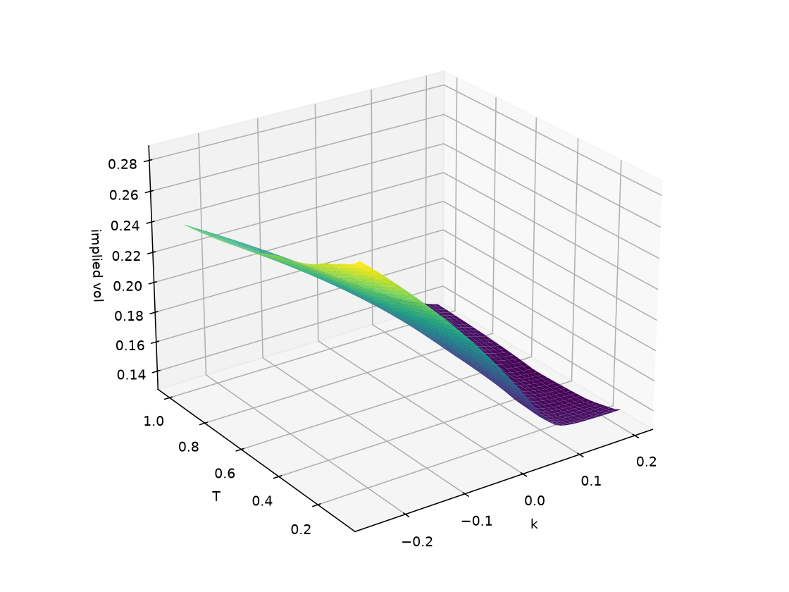

# Derivatives Pricing Engine

[](https://github.com/aod431/derivatives-pricing-engine/actions/workflows/ci.yml)


A Python library for pricing equity derivatives, built to learn the models properly. It starts with Black-Scholes and Monte Carlo and goes up to Heston, SVI and American options. Every model is checked against another method (closed form vs Monte Carlo, tree vs PDE, Fourier vs simulation), and every method has a short document and a notebook.

Two applications sit on top of it: [`vol-surface-risk/`](vol-surface-risk/), which builds an implied volatility surface from a real SPY option chain and serves pricing and risk through an API, and [`cpp/`](cpp/), a small C++ port with a benchmark.

## Results

A European call (S = K = 100, T = 1, r = 5%, sigma = 20%, q = 2%) priced five ways. All of them agree with the closed form:

| Method | Price | Abs. error vs Black-Scholes | Note |
|---|---|---|---|
| Black-Scholes (reference) | 9.2270 | 0 | closed form |
| Monte Carlo, 1,000,000 paths | 9.2327 | 0.0057 | standard error 0.0138 |
| Sobol quasi-Monte Carlo, 16 x 2^14 points | 9.2269 | 0.0001 | standard error 0.00015 |
| Binomial tree, 1,000 steps | 9.2251 | 0.0019 | |
| Crank-Nicolson PDE, 400 x 400 grid | 9.2279 | 0.0009 | |

Other checks that run in the test suite and the notebooks:

- American put: binomial tree 6.6602, PDE 6.6601, Longstaff-Schwartz 6.6144 (standard error 0.024; it is a low-biased estimator, as expected).
- Heston call: Fourier inversion 8.7526 against Monte Carlo 8.7832 (standard error 0.023).
- Delta: analytical 0.586851 against central finite difference 0.586851.

<p align="center">
  
  
</p>
<p align="center">
  
  
</p>

*Top left: Monte Carlo error falls like 1/sqrt(N). Top right: in Heston, the correlation sets the skew. Bottom left: the spread of the P&L of a discretely delta-hedged short call shrinks like 1/sqrt(n) with the number of rebalances. Bottom right: implied volatility surface built from an option chain (see `vol-surface-risk`).*

## Quick start

```bash
git clone https://github.com/aod431/derivatives-pricing-engine.git
cd derivatives-pricing-engine
python -m venv .venv && source .venv/bin/activate
pip install -e ".[dev]"
pytest
```

```python
from pricing.black_scholes import black_scholes_price
from pricing.greeks import analytical_greeks
from pricing.implied_vol import implied_volatility
from pricing.monte_carlo import mc_price

S, K, T, r, sigma, q = 100, 100, 1.0, 0.05, 0.20, 0.02

price = black_scholes_price(S, K, T, r, sigma, "call", q)          # 9.2270
greeks = analytical_greeks(S, K, T, r, sigma, "call", q)           # delta 0.5869, gamma, vega, theta, rho
mc = mc_price(S, K, T, r, sigma, "call", q, n_paths=1_000_000)     # price with standard error and 95% CI
iv = implied_volatility(price, S, K, T, r, "call", q)              # back to 0.20
```

## What is inside

Three levels, so you can stop wherever you like.

**1. Basics**

| Topic | Code | Notes | Notebook |
|---|---|---|---|
| Black-Scholes | `black_scholes` | [theory](docs/black_scholes.md) | `01_black_scholes` |
| Monte Carlo | `monte_carlo` | [theory](docs/monte_carlo.md) | `02_monte_carlo_convergence` |
| Greeks | `greeks` | [theory](docs/greeks.md) | `03_greeks` |
| Implied volatility | `implied_vol` | [theory](docs/implied_vol.md) | `04_implied_volatility` |

**2. Numerical methods and products**

| Topic | Code | Notes | Notebook |
|---|---|---|---|
| Binomial tree (European and American) | `binomial` | [theory](docs/binomial.md) | `05_binomial` |
| Asian options, control variate | `exotics` | [theory](docs/exotics.md) | `06_exotics` |
| Finite differences (Crank-Nicolson) | `pde` | [theory](docs/pde.md) | `09_pde_tree_mc_comparison` |
| Quasi-Monte Carlo and Greeks by Monte Carlo | `quasi_mc`, `mc_greeks` | [theory](docs/mc_greeks.md) | `13_mc_greeks` |
| Delta hedging simulation | `hedging` | [theory](docs/hedging.md) | `12_delta_hedging_pnl` |

**3. Smile, surface and harder products**

| Topic | Code | Notes | Notebook |
|---|---|---|---|
| Heston stochastic volatility | `heston` | [theory](docs/heston.md) | `07_heston_smile` |
| SABR and SVI, no-arbitrage checks | `sabr`, `svi` | [SABR](docs/sabr.md), [SVI](docs/svi.md) | `08_sabr_svi_calibration` |
| American options by Longstaff-Schwartz | `lsm` | [theory](docs/american_lsm.md) | `10_american_lsm` |
| Barrier options | `barrier` | [theory](docs/barrier.md) | `11_barrier_options` |
| GARCH volatility on SPY | uses the `arch` package | | `14_garch_volatility` |

Start with [`docs/foundations.md`](docs/foundations.md) for the maths behind all of it (Ito, risk-neutral pricing, put-call parity) and [`docs/interview_cheatsheet.md`](docs/interview_cheatsheet.md) for a one-page summary. Each document ends with interview questions. The reading order is in [`docs/README.md`](docs/README.md).

## Applications

- [`vol-surface-risk/`](vol-surface-risk/): downloads a SPY option chain with `yfinance`, cleans it, gets the forward from put-call parity, fits SVI per expiry, checks butterfly and calendar arbitrage, and exposes pricing, Greeks, scenarios and VaR through a FastAPI service. It also runs offline on a committed sample.
- [`cpp/`](cpp/): Black-Scholes, Monte Carlo and the binomial tree in C++17 with a plain Makefile, tests, Python bindings and a speed benchmark against the Python code.

## Tests and reproducing the figures

```bash
pytest                                   # library tests
cd vol-surface-risk && pytest            # application tests (offline)
cd cpp && make test                      # C++ tests
python scripts/make_readme_figures.py    # regenerates docs/img/* and prints the table above
```

The tests check limits and relations rather than hard-coded outputs: put-call parity, convergence rates, in-out parity for barriers, agreement between independent methods, and Greeks against finite differences. CI runs them on Python 3.10 and 3.12.

## Limitations

This is a learning and portfolio project, not production pricing code. It assumes constant rates and dividend yields, a single underlying, and ignores market conventions such as day counts, calendars and discrete dividends. Calibrations are plain least squares. Heston Monte Carlo uses a simple Euler scheme, which is biased with few time steps. The documents say where each model is known to fail.
