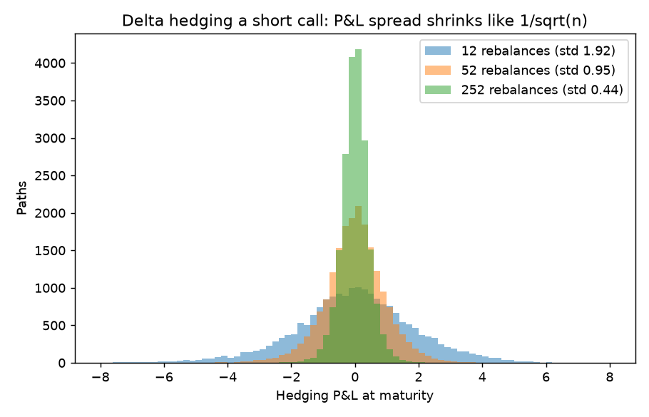

# Delta hedging: where the P&L comes from

Implementation: [`src/pricing/hedging.py`](../src/pricing/hedging.py)
Verification notebook: [`notebooks/12_delta_hedging_pnl.ipynb`](../notebooks/12_delta_hedging_pnl.ipynb)

## 1. The experiment

A trader sells a European call at the Black-Scholes price for an implied vol $\sigma_{imp}$, buys $\Delta=N(d_1)$ shares financed at $r$, and rebalances to the new Black-Scholes delta (computed with $\sigma_{imp}$) $n$ times until maturity, when the option is settled. The stock actually moves with realised vol $\sigma_{real}$. `delta_hedge_pnl` returns the terminal P&L, in time-$T$ money, for each simulated path.

Black-Scholes says that if you hedge continuously and $\sigma_{real}=\sigma_{imp}$, the P&L is exactly zero in every scenario. The simulation shows what is left when those two assumptions are relaxed.

## 2. Gamma and theta: the P&L identity

Over a short interval the hedged option position earns, per unit of time, theta plus the gamma term. Using the Black-Scholes PDE to replace theta by gamma, one gets the well-known result

$$\text{P\&L} \approx \int_0^T e^{r(T-t)}\;\tfrac12\,\Gamma_t S_t^2\left(\sigma_{imp}^2 - \sigma_{real}^2\right)dt$$

where $\Gamma_t$ is the Black-Scholes gamma at $\sigma_{imp}$. Three consequences:

- The short-option trader **earns theta and pays for gamma**. The realised move $\tfrac12\Gamma S^2\,(dS/S)^2$ pays the gamma, theta is what was collected. They cancel when realised variance equals the implied variance.
- The P&L is path-dependent: it is the gamma-weighted gap between variances, so the gamma is largest where the stock sits near the strike late in life.
- The drift $\mu$ of the stock does not appear. It is the mechanical reason why risk-neutral pricing works.

## 3. Worked example: mean of the P&L

$S_0=K=100$, $T=1$, $r=5\%$, $q=0$. Black-Scholes prices: 10.450584 at $\sigma=20\%$, 14.231254 at $\sigma=30\%$. 20,000 paths.

| $\sigma_{imp}$ | $\sigma_{real}$ | Rebalances | Mean P&L | Std of P&L |
|---|---|---|---|---|
| 0.20 | 0.20 | 100 | 0.0029 | 0.7023 |
| 0.30 | 0.20 | 100 | 3.9801 | 1.3892 |
| 0.30 | 0.20 | 252 | 3.9783 | 1.2820 |
| 0.20 | 0.30 | 100 | -3.9818 | 2.1188 |

Sold too rich: profit about $+3.98$. Sold too cheap: loss about $-3.98$. In the continuous-hedging limit the expected P&L equals the difference in prices at the two vols, compounded to maturity: $(14.231254-10.450584)\,e^{0.05}=3.9745$, and the simulation gives 3.98. So the trade is a bet on **realised minus implied variance**, the thing a vega position expresses, and the hedge only removes the directional risk. With matching vols the mean is zero within noise (0.0029 against a standard error of $0.7023/\sqrt{20000}=0.005$).

## 4. Discrete rebalancing and the $\sqrt n$ law

With $\sigma_{real}=\sigma_{imp}=20\%$, 20,000 paths:

| Rebalances $n$ | Mean P&L | Std of P&L |
|---|---|---|
| 4 | -0.0293 | 3.2576 |
| 12 | -0.0198 | 1.9175 |
| 52 | -0.0045 | 0.9544 |
| 252 | 0.0037 | 0.4362 |

The mean is zero up to noise, but the dispersion is not: it falls like $1/\sqrt n$. From 4 to 252 rebalances ($63\times$ more) the standard deviation falls by $3.2576/0.4362=7.5$ against $\sqrt{63}=7.9$ expected. Each rebalancing interval leaves a gamma-times-noise residual $\tfrac12\Gamma S^2(Z^2-1)\sigma^2\Delta t$ with mean zero, and these add as independent terms: variance $\propto n\cdot(1/n)^2=1/n$.

Practical reading: with daily hedging of a one-year ATM call the residual standard deviation is 0.44, about 4% of the 10.45 premium. Hedging more often reduces it but never to zero, and real rebalancing has transaction costs, which grow with $n$. Optimal rebalancing is a trade-off between the two.

## 5. Things the simulation does not include

Transaction costs, discrete (non-continuous) stock paths with jumps, and a volatility that is itself stochastic. Under jumps the hedging error does not vanish even as $n\to\infty$. Under stochastic vol, delta hedging alone leaves a vega exposure: that is what the smile models ([Heston](heston.md), [SABR](sabr.md)) are for.

## Interview questions

**1. You are short a call and hedge delta daily. Where does the P&L come from?**
Gamma versus theta: you earn theta (time decay) and lose when the stock moves more than the implied move. The P&L is approximately $\tfrac12\Gamma S^2(\sigma_{imp}^2-\sigma_{real}^2)\,dt$ at each step.

**2. If the real drift is higher than $r$, does a delta-hedged option position make more money?**
No. In the continuous limit the hedged P&L is independent of $\mu$. In the simulation with $\mu=15\%$ and matching vols (100 rebalances) the mean P&L was $-0.012$ with std 0.66, i.e. zero.

**3. How does the P&L spread scale with the hedging frequency?**
Like $1/\sqrt n$, as in the table above. It never reaches zero at finite $n$.

**4. When is a long gamma position profitable?**
When realised vol exceeds the implied vol paid. The breakeven daily move is $\sigma_{imp}/\sqrt{252}$.

**5. Why does gamma peak at the strike near expiry?**
$\Gamma=\phi(d_1)/(S\sigma\sqrt T)$ and $d_1\approx0$ at the money: the $1/\sqrt T$ makes it blow up as $T\to0$, which is why pin risk and hedging near expiry are hard.

**6. Why does the vega-hedge matter if you already delta-hedge?**
Delta hedging removes spot risk, but the P&L above still depends on realised versus implied volatility, so unhedged vega is the dominant risk.
