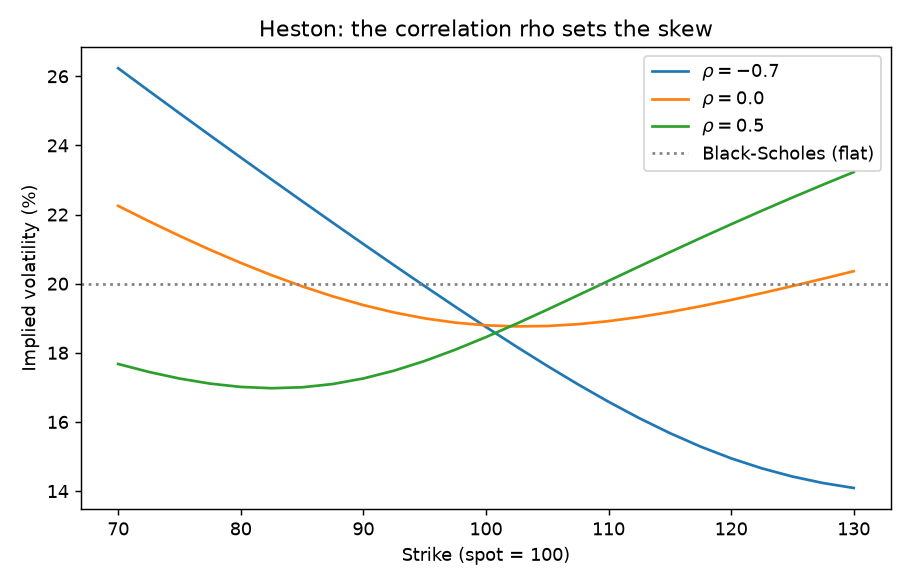

# Heston stochastic volatility

Implementation: [`src/pricing/heston.py`](../src/pricing/heston.py)
Verification notebook: [`notebooks/07_heston_smile.ipynb`](../notebooks/07_heston_smile.ipynb)

## 1. Why a stochastic variance

Black-Scholes cannot produce a smile. Heston lets the variance $v_t$ move randomly and correlate with the spot, under $\mathbb{Q}$:

$$dS = (r-q)S\,dt + \sqrt{v}\,S\,dW^1, \qquad dv = \kappa(\theta - v)\,dt + \xi\sqrt{v}\,dW^2, \qquad d\langle W^1,W^2\rangle = \rho\,dt$$

- $v_0$: initial variance; $\theta$: long-run variance; $\kappa$: mean-reversion speed.
- $\xi$: vol of vol. It controls the **curvature** (smile).
- $\rho$: spot-vol correlation. It controls the **skew**.
- **Feller condition** $2\kappa\theta \ge \xi^2$: if it holds, $v$ never reaches zero. Equity calibrations usually violate it, and `HestonParams.feller_satisfied` reports it (for $\kappa=1$, $\theta=0.04$, $\xi=1$: $2\kappa\theta = 0.08 < 1$).

## 2. Semi-analytic price by Fourier inversion

The model is affine, so the characteristic function of $\ln S_T$ is known in closed form. Gil-Pelaez recovers the probabilities from it:

$$C = S e^{-qT}P_1 - Ke^{-rT}P_2, \qquad P_j = \tfrac12 + \frac1\pi\int_0^\infty \mathrm{Re}\!\left[\frac{e^{-iu\ln K}\,\phi_j(u)}{iu}\right]du$$

$P_2$ is the risk-neutral probability of finishing in the money, and $P_1$ is the same under the share measure. The code uses the "little Heston trap" form of $\phi$ (the $e^{-dT}$ version): the original formulation has a complex logarithm that jumps by $2\pi i$ for long maturities or large $\xi$, which silently corrupts the price. The integral uses 400 Gauss-Legendre nodes on $[0,200]$, and one price takes about 7 ms, which is what makes calibration feasible.

## 3. Worked example

Parameters: $S_0=100$, $T=1$, $r=3\%$, $q=1\%$, $v_0=\theta=0.04$, $\kappa=2$, $\xi=0.5$, $\rho=-0.7$. Black-Scholes implied vols obtained by inverting the Heston prices:

| Strike | Heston call | Implied vol |
|---|---|---|
| 80 | 22.9575 | 0.2345 |
| 90 | 14.9420 | 0.2093 |
| 100 | 8.2529 | 0.1852 |
| 110 | 3.5351 | 0.1637 |
| 120 | 1.0958 | 0.1480 |

A downward skew, as in equity. Effect of each parameter on the vols at strikes 80/100/120:

| Setting | 80 | 100 | 120 |
|---|---|---|---|
| $\rho=-0.7$ | 0.2345 | 0.1852 | 0.1480 |
| $\rho=0$ | 0.2048 | 0.1878 | 0.1962 |
| $\rho=+0.7$ | 0.1478 | 0.1844 | 0.2269 |
| $\rho=0$, $\xi=0.2$ | 0.2011 | 0.1977 | 0.1992 |
| $\rho=0$, $\xi=1.0$ | 0.2086 | 0.1669 | 0.1899 |

$\rho$ tilts the smile, $\xi$ bends it. Setting $\xi=10^{-3}$, $\rho=0$ gives 8.827319 versus Black-Scholes 8.827321 at $\sigma=20\%$: Heston reduces to BS when the variance is deterministic and constant.

## 4. Monte Carlo and discretisation bias

`heston_mc_price` uses an Euler scheme with **full truncation**: $v^+=\max(v,0)$ in every drift and diffusion term, so a negative discretised variance never feeds back. Comparison with the Fourier price (200k paths, 200 steps):

| Strike | Fourier | MC | MC std error |
|---|---|---|---|
| 80 | 22.9575 | 22.9887 | 0.0339 |
| 100 | 8.2529 | 8.2820 | 0.0223 |
| 120 | 1.0958 | 1.1002 | 0.0084 |

Effect of the number of time steps at $K=100$ (400k paths, std error $\approx$ 0.016): 5 steps gives 8.5526, 20 gives 8.2717, 100 gives 8.2804, 400 gives 8.2659 against the exact 8.2529. With only 5 steps the bias (+0.30) is far above the sampling error. With 20 steps or more the remaining gap, between 0.013 and 0.028, is at the level of the std error, so I cannot distinguish it from noise at this path count. This model violates Feller ($2\kappa\theta=0.16 < \xi^2=0.25$), which is where Euler is weakest; Andersen's quadratic-exponential scheme is the standard fix and is not implemented here.

## 5. Calibration in practice

Five parameters are fitted to the smile by least squares on implied vols (or on prices weighted by vega). It is non-convex: $\kappa$ and $\theta$ trade off against each other for short maturities, and $\rho$-$\xi$ correlate. Good practice is to start from a sensible guess, bound the parameters and check the Feller flag. A single set of Heston parameters fits one maturity well but struggles on the full term structure, particularly short expiries, where the smile is steeper than Heston allows. That limit is one reason desks use SABR or SVI for interpolation and Heston-like models for pricing exotics.

## Interview questions

**1. Which parameter creates skew and which creates smile curvature?**
$\rho$ creates skew (asymmetry between low and high strikes); $\xi$ creates curvature. $\rho=0$ with positive $\xi$ gives a symmetric smile (see table).

**2. What is the Feller condition and what happens if it fails?**
$2\kappa\theta\ge\xi^2$ keeps $v>0$. If it fails, $v$ can touch 0 (and is reflected); the process is still well defined but Euler schemes produce negative variances, which need truncation or a better scheme.

**3. Why is Fourier pricing much better than Monte Carlo for calibration?**
It is deterministic, accurate to many digits and about 7 ms here, so the optimiser sees a smooth objective. MC noise makes finite-difference gradients useless.

**4. Why does the original Heston characteristic function misbehave?**
The complex square root and logarithm have branch cuts. In the original form the integrand crosses a cut for long maturities, producing jumps; the rotated (little trap) form keeps the argument inside the principal branch.

**5. How does Heston relate the skew to the leverage effect?**
Negative $\rho$ means falling spot raises variance, so the left tail is fatter than lognormal and low-strike options are more expensive.

**6. What does Heston not capture?**
Steep short-dated skew (no jumps), and it cannot match all maturities with one parameter set. Adding jumps (Bates) or using local-stochastic volatility addresses this.
