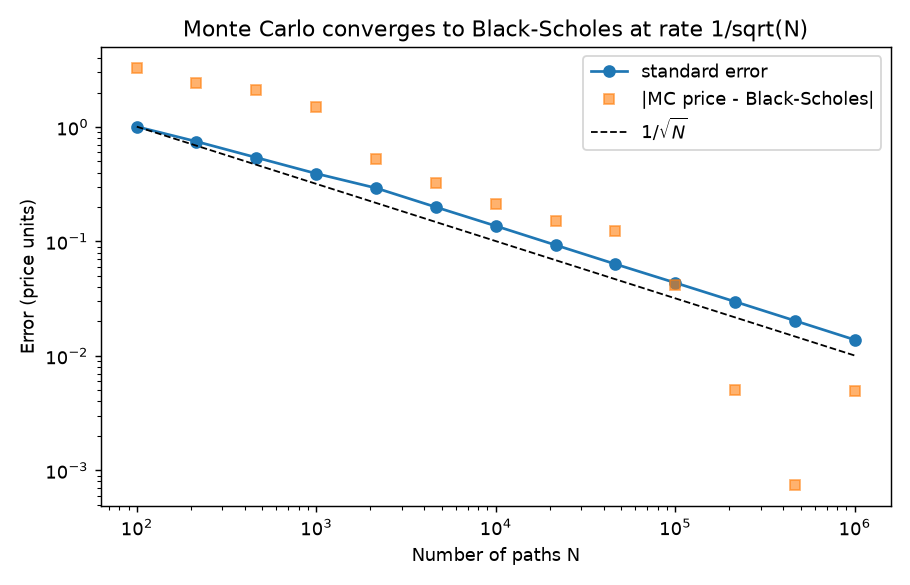

# Monte Carlo pricing

Implementation: [`src/pricing/monte_carlo.py`](../src/pricing/monte_carlo.py)
Verification notebook: [`notebooks/02_monte_carlo_convergence.ipynb`](../notebooks/02_monte_carlo_convergence.ipynb)

## 1. Why the price is a discounted expectation

As with Black-Scholes, $\text{Price}_0 = e^{-rT}\,\mathbb{E}^{\mathbb{Q}}[\text{payoff}(S_T)]$. Black-Scholes can solve this expectation in closed form for a plain European option, but as soon as the payoff gets more complex (path-dependent, multi-asset, barrier, Asian...) there is often no closed-form solution. **Monte Carlo is a numerical way to compute the same expectation**: simulate many possible scenarios for $S_T$ under $\mathbb{Q}$, compute the payoff in each, average, and discount. The Law of Large Numbers guarantees this sample average converges to the true expectation as $N \to \infty$.

## 2. Why the error decays as $1/\sqrt{N}$

By the Central Limit Theorem, if $X_1, \dots, X_N$ are i.i.d. discounted payoffs with variance $\sigma_X^2$, the standard error of the sample mean is

$$\text{SE} = \frac{\sigma_X}{\sqrt{N}}$$

To halve the error you need **4x** more simulations — diminishing returns. This motivates variance reduction techniques: the convergence *rate* ($N^{-1/2}$) is unavoidable for plain Monte Carlo, but the *constant* $\sigma_X$ in front of it can be reduced.

## 3. Antithetic variates

For every draw $Z \sim \mathcal{N}(0,1)$, also use its mirror $-Z$ (equally valid, since the normal distribution is symmetric). If the payoff is a monotonic function of $Z$, averaging $f(Z)$ and $f(-Z)$ tends to cancel part of the variance between pairs, without introducing bias. It does **not** change the $N^{-1/2}$ rate — it reduces $\sigma_X$.

## 4. Worked example and an honest finding

Parameters used in [`notebooks/02_monte_carlo_convergence.ipynb`](../notebooks/02_monte_carlo_convergence.ipynb) (same as the Black-Scholes example): $S_0=100$, $K=100$, $T=1$, $r=5\%$, $\sigma=20\%$, $q=2\%$. Black-Scholes reference call price: **9.227006**.

| N | Price (plain) | SE (plain) | Price (antithetic) | SE (antithetic) | Variance reduction factor |
|---|---|---|---|---|---|
| 100 | 6.661754 | 0.926043 | 7.094867 | 1.019490 | 0.908 |
| 1,000 | 8.705286 | 0.420780 | 8.797469 | 0.416772 | 1.010 |
| 10,000 | 9.128623 | 0.138822 | 9.183628 | 0.138710 | 1.001 |
| 100,000 | 9.201616 | 0.043963 | 9.241294 | 0.043919 | 1.001 |
| 1,000,000 | 9.229672 | 0.013844 | 9.232719 | 0.013849 | 1.000 |

**Standard error convergence matches theory almost exactly**: going from $N=10^4$ to $N=10^6$ (a 100x increase), the plain SE falls from 0.138822 to 0.013844 — a factor of 0.0997, versus the theoretical $1/\sqrt{100}=0.1$.

**Antithetic variates give essentially no benefit here** (variance reduction factor $\approx 1.00$ throughout, instead of a large improvement). This is not a bug — it is a known limitation: antithetic variates work best on smooth, near-linear payoffs. A vanilla call has a kink at $S_T=K$ ($\max(\cdot,0)$), and roughly half the simulated paths produce a payoff of exactly zero (out-of-the-money) at this at-the-money strike ($S_0=K=100$) — precisely the setting where the negative correlation between $f(Z)$ and $f(-Z)$ that makes antithetic variates work is weakest. A deep in/out-of-the-money option, or a more linear payoff (e.g. a forward), would show a larger benefit.

## 5. Quasi-Monte Carlo and Monte Carlo Greeks

Antithetic variates only change the constant in front of $N^{-1/2}$. Replacing pseudo-random draws by a scrambled Sobol sequence changes the rate itself for smooth low-dimensional payoffs: in the one-dimensional European call, the standard error across 16 scrambles falls from 0.007191 at 4,096 points to 0.000150 at 262,144, against 0.22675 to 0.02888 for plain Monte Carlo. Details, caveats about dimension, and the pathwise, likelihood-ratio and bump estimators of Greeks are in [`mc_greeks.md`](mc_greeks.md) (code in [`src/pricing/quasi_mc.py`](../src/pricing/quasi_mc.py)).

## Interview questions

**1. Why is the Monte Carlo error $O(N^{-1/2})$ whatever the dimension?**
The CLT: the standard error of a mean of $N$ i.i.d. samples is $\sigma/\sqrt N$, with no dependence on the dimension of the integral. That is why Monte Carlo wins over grids in high dimension.

**2. How do you report a Monte Carlo price?**
The estimate together with its standard error or a 95% confidence interval (as `MonteCarloResult` does), never the point estimate alone.

**3. Why did antithetic variates do almost nothing in the example above?**
The call payoff is kinked and about half of the paths have zero payoff at the money, so $f(Z)$ and $f(-Z)$ are weakly negatively correlated. They help more on monotone, near-linear payoffs.

**4. What is a control variate?**
A quantity correlated with the payoff whose expectation is known exactly (the geometric Asian in [`exotics.md`](exotics.md)). Subtract its fluctuation: the variance is reduced by a factor of $1-\rho^2$ at the optimal coefficient.

**5. Does Monte Carlo handle American options?**
Not directly, because simulation goes forward and early exercise needs a backward decision. Regression (Longstaff-Schwartz, [`american_lsm.md`](american_lsm.md)) solves this.

**6. What biases remain after you add paths?**
Discretisation bias (time steps in Euler schemes, discrete barrier monitoring) and model error. Sampling error disappears as $N\to\infty$; those do not.

