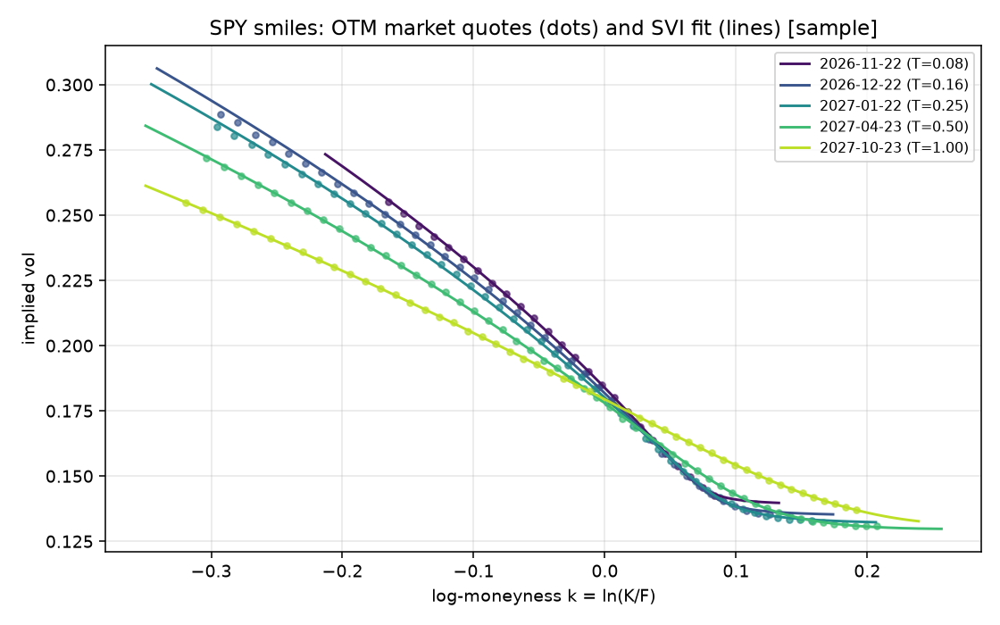
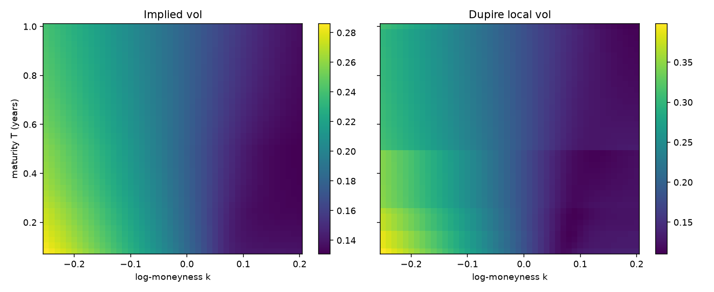

# vol-surface-risk

Market data in, arbitrage-checked implied volatility surface out, then pricing and risk on top of it, served over an HTTP API.
It is the "production" side of the repository: the models live in the parent package (`pricing`: Black-Scholes, implied vol, SVI, Heston...), and this project wires them into a pipeline with data cleaning, calibration, diagnostics, risk numbers, tests and a service.

## Pipeline

```
 Yahoo Finance (yfinance)                      data/sample_SPY.csv (synthetic, Heston)
          |  fetch / cache as CSV snapshot               |
          v                                              v
 +--------------------------------------------------------------+
 | data.py      quality filters -> parity forward per expiry    |
 |              -> keep OTM quotes only                         |
 +--------------------------------------------------------------+
          |  PreparedChain (quotes, forwards, cleaning report)
          v
 +--------------------------------------------------------------+
 | surface.py   implied vol per quote (Brent, parity forward)   |
 |              per-expiry SVI fit, spread-based weights        |
 |              butterfly + calendar checks, penalised refit    |
 |              VolSurface: vol(K,T), local_vol(K,T), diagnostics
 +--------------------------------------------------------------+
          |  VolSurface
          v
 +-----------------------------+      +--------------------------+
 | risk.py                     |      | api.py (FastAPI)         |
 |  portfolio value, Greeks    | <--- |  GET  /health            |
 |  bucketed vega              |      |  GET  /surface/{symbol}  |
 |  spot x vol scenario grids  |      |  POST /price             |
 |  MC VaR / ES (2 methods)    |      |  POST /risk              |
 +-----------------------------+      +--------------------------+
          ^
          |  cli.py:  python -m volrisk.cli build | demo
```

## Run it

The parent package is not on PyPI, so install it first (from the repository root, inside a virtualenv):

```bash
pip install -e .                 # parent: the `pricing` package
pip install -e "vol-surface-risk[dev]"
cd vol-surface-risk

python -m pytest -q                    # 51 tests, offline
python -m volrisk.cli demo             # end-to-end on the synthetic sample, no network
python -m volrisk.cli build --symbol SPY   # real chain from Yahoo, saved to data/SPY_<date>.csv
python scripts/plot_surface.py         # figures into docs/img/
VOLRISK_SOURCE=sample uvicorn volrisk.api:app    # http://localhost:8000/docs
```

`make test | demo | serve | live | plots` do the same (`Makefile`, adjust `PY` to your interpreter).
`Dockerfile` builds from the repository root (`docker build -f vol-surface-risk/Dockerfile -t volrisk .`); I could not run Docker in my environment, so that file is untested.
CI for this folder runs from the repository root (`.github/workflows/ci.yml`): tests and the offline demo on Python 3.10 and 3.12.

### API examples

```bash
curl localhost:8000/health
curl localhost:8000/surface/SPY            # SVI parameters and diagnostics per expiry

curl -X POST localhost:8000/price -H 'content-type: application/json' \
  -d '{"symbol":"SPY","option_type":"call","strike":520,"maturity":0.25}'
# {"price":9.9977,"vol":0.1656,"vol_source":"surface","forward":504.03,
#  "greeks":{"delta":0.3675,"gamma":0.00908,"vega_per_vol_pt":0.9398,"theta_per_day":-0.1002},"warnings":[]}

curl -X POST localhost:8000/risk -H 'content-type: application/json' -d '{
  "symbol":"SPY",
  "positions":[{"option_type":"call","strike":520,"maturity":0.25,"quantity":-100},
               {"option_type":"put","strike":480,"maturity":0.25,"quantity":-100}],
  "spot_shifts":[-0.05,0,0.05], "vol_shifts":[-0.02,0,0.02]}'
```

Invalid input (negative strike, unknown option type, empty portfolio, confidence outside (0.5, 1)...) returns a 422 with the pydantic message; an unknown symbol returns 404. Maturities outside the calibrated range are priced with flat extrapolation and a `warnings` entry says so.
The API only reads stored snapshots, never Yahoo, so latency and results do not depend on a third party being up.
`VOLRISK_SOURCE=sample` always serves the synthetic sample; without it the newest real snapshot is used, and `VOLRISK_ALLOW_SAMPLE=1` permits falling back to the sample when there is none. The sample is never used silently.

## What each stage does, and why

### 1. Data (`data.py`)

Filters, in order, with a count of what each one removed: invalid numbers, zero bid, crossed/locked market, expiries under 7 days, stale last trade (more than 5 days old), open interest below 10, mid below 0.10, relative spread above 50%.

The forward of each expiry is **estimated from put-call parity**, `F = K + (C - P) e^{rT}`, as the median over the five pairs closest to spot, instead of assuming `S e^{(r-q)T}`. The implied carry `q = r - ln(F/S)/T` falls out of it and is what the Black-Scholes inversion uses, so the vols are consistent with the market's own forward whatever the true dividends and borrow are. Expiries with fewer than two call/put pairs are dropped.

Only **out-of-the-money** quotes are kept (calls above the forward, puts below). OTM options have no meaningful early-exercise value, which is what makes it defensible to treat American-style SPY options as European, and they carry the most vega per tick of bid-ask noise.

Everything is cached as CSV + JSON, so the project runs offline. The committed `data/sample_SPY.csv` is **synthetic**: prices from the Heston model with known parameters (`scripts/make_sample.py`), cent ticks, noisy mids, and six deliberately bad rows that the tests check are removed. Having the true model lets the tests measure calibration error against ground truth, which real data cannot do.

### 2. Surface (`surface.py`)

- Implied vol per quote by Brent root-finding (`pricing.implied_volatility`).
- One raw-SVI slice per expiry, fit in total variance `w = sigma^2 T` against `k = ln(K/F)`. The weight of a quote is the inverse variance of `w`, from its bid-ask half-width converted to vol terms: `(ask - bid) / (2 vega)`, then `dw = 2 sigma T d(sigma)`. Wide, low-vega quotes count little.
- **Butterfly** check: Gatheral's `g(k) >= 0` on `k in [-1.5, 1.5]`. **Calendar** check: total variance must not decrease from one expiry to the next, checked on the data range (plus 0.1) of the two slices.
- A slice that fails either check is refit with penalties on the violated constraint, using the previous slice as the floor. Because the penalty is soft, a final minimal parallel lift of `w` removes any residual crossing, and the checks are **run again and reported**, never assumed.
- `VolSurface.vol(K, T)`: total variance is interpolated **linearly in T at fixed log-moneyness**, which cannot introduce calendar arbitrage between arbitrage-free slices. Outside the quoted maturities the vol is held flat.
- `VolSurface.local_vol(K, T)`: Dupire in Gatheral's total-variance form, with finite-difference derivatives. It returns NaN where the denominator or `dw/dT` is not positive, and `diagnostics()` reports the share of invalid grid points.

### 3. Risk (`risk.py`)

- Each option is priced with Black-Scholes at its surface vol and the surface carry. Vol is **sticky-strike**: if spot moves, an option keeps the vol of its strike, plus any explicit shock. The reported delta is therefore the BS delta, without a skew term.
- Greeks: delta, gamma, vega (per vol point), theta (per day).
- **Bucketed vega**: the vol bump is spread over expiries with triangular weights centred on each calibrated slice (weights sum to one at any maturity) and the P&L is a full revaluation, so the buckets add up to the parallel vega (tested).
- **Scenario grid**: P&L by full revaluation over spot shifts x parallel vol shifts, plus skew-tilt scenarios (vol change proportional to log-moneyness).
- **VaR / ES** (1 day, Monte Carlo, Student-t with 5 degrees of freedom, spot-vol correlation -0.7) computed two ways on the same draws: exact revaluation, and a delta-gamma-vega Taylor approximation. `risk_report` returns both and the error between them. A historical version only needs the factor arrays: `var_es`, `pnl_full_revaluation` and `pnl_delta_gamma_vega` take any `(spot return, vol change)` sample.

## Results

Numbers below come from running this code (synthetic sample, `python -m volrisk.cli demo`).

**Cleaning.** 516 raw quotes, 466 survive the filters, 211 OTM quotes are used. The six planted bad rows are removed.

**Forwards.** The parity forward recovers the true carry (1.3%) to within 0.06 percentage points (1.28% to 1.36%); the error is largest at the shortest maturity, where `ln(F/S)/T` amplifies the cent-level noise in the mids.

**Fit.** Per-slice RMSE against the market implied vols is 0.015 to 0.105 vol points across the five expiries. Against the true Heston vols at 48 off-grid points (strikes and maturities that were never quoted) the surface error is 0.07 vol points on average and 0.15 at worst. All five slices are butterfly-free (min `g` about 0.27 to 0.31) and calendar-free, and none needed repair. The Dupire local vol is valid on the whole test grid.

| expiry | T | forward | quotes | RMSE (vol pts) |
|---|---|---|---|---|
| 2026-11-22 | 0.082 | 501.29 | 25 | 0.045 |
| 2026-12-22 | 0.164 | 502.64 | 40 | 0.105 |
| 2027-01-22 | 0.249 | 504.02 | 44 | 0.071 |
| 2027-04-23 | 0.499 | 508.08 | 51 | 0.032 |
| 2027-10-23 | 1.000 | 516.20 | 51 | 0.015 |




The local-vol heatmap shows horizontal bands. That is the linear-in-T interpolation of total variance: `dw/dT` is piecewise constant between expiries. A smoother interpolation in T would remove it, at the cost of having to police calendar arbitrage again.

**Risk demo.** Portfolio: short 100 x 3m 520 call, short 100 x 3m 480 put, long 50 x 6m 500 call, long 80 x 1y 450 put. Value 735.4, delta 3.37, gamma -1.07, vega +7.76 per vol point, theta +11.0 per day. Bucketed vega is -179.6 in the January slice (the short strangle) and +68.2 / +119.2 in the April and October slices (the long options), summing to 7.759 against 7.760 for the parallel vega.

1-day 99% VaR / ES of this book: 141 / 251 by full revaluation, 174 / 317 by delta-gamma-vega, so **the approximation overstates VaR by 23%**. This is a short-gamma book with large vega, and the Taylor expansion drops the spot-vol cross term (vanna), vol convexity and higher-order gamma, which matter in the tails. On a delta-dominated book (long 100 calls, short puts and calls) the two agree within 0.3%. Both behaviours are asserted in the tests, because "the approximation is fine" is only true for some portfolios.

**Live data.** `python -m volrisk.cli build --symbol SPY` on a real SPY chain (2796 quotes, 8 expiries from 7 days to about 1 year) kept 1744 quotes after cleaning (about 570 stale and 150 zero-bid dropped), calibrated 8 slices with RMSE of 0.13 to 0.31 vol points, all butterfly- and calendar-free after the penalised refit, which was triggered on 5 of the 8. RMSE on real quotes is 2 to 5 times larger than on the synthetic ones, which is what noisy mids and non-simultaneous quotes do. Live snapshots are git-ignored.

## Limitations

- **American exercise.** SPY options are American. OTM-only plus parity at the money limits the damage, but the parity forward is biased by the early-exercise premium of the puts, and the short-dated implied carry on live data came out negative (as low as -4%). The vols are unaffected because they use the forward directly, but `carry(T)` should not be read as a dividend yield.
- **Spot and option quotes are not simultaneous** on a free data feed (the last close versus quotes at fetch time). Using the parity forward instead of `S e^{(r-q)T}` makes the vols robust to this; absolute delta/theta are not.
- **Flat rate.** One continuously compounded `r` for all maturities (13-week T-bill via `^IRX`, else 4.5%). A real desk uses a curve.
- **SVI constraints are soft.** Fits are penalised and re-checked, not provably arbitrage-free in the wings: the butterfly check runs on a finite grid, the calendar check on the data range of the two slices. Short-dated slices often end at the `rho = -0.999` bound because after cleaning there are few OTM calls on the right wing; the fit is good where there is data and is not trustworthy outside it.
- **Interpolation.** Linear in total variance gives calendar-free vols but non-smooth local vol in T.
- **Risk model.** The risk factors are only spot and a parallel vol move; there is no skew or term-structure risk in the VaR, no rates risk, and the vol of each option is held at its current surface vol (no roll-down) over the horizon. Vol-of-vol (1 vol point/day) and correlation (-0.7) are inputs, not estimates.
- **Not tested:** the Dockerfile, the CI workflow (it has not run on GitHub yet), and the live fetch in CI (tests are offline by design).

## Layout

```
src/volrisk/   data.py  surface.py  risk.py  api.py  cli.py
scripts/       make_sample.py  plot_surface.py
tests/         test_data.py  test_surface.py  test_risk.py  test_api.py
data/          sample_SPY.csv/.json (tracked, synthetic)   SPY_<date>.* (ignored, real)
docs/img/      figures produced by plot_surface.py
```
